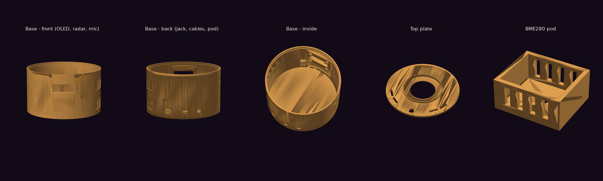

# Athena Desk Orb

An ESP32 desk companion for **Athena**, my personal AI assistant. A frosted dome glows in Athena's colours to show what she is doing (listening, thinking, speaking), a button makes her listen, and the base carries room sensors and a presence radar.



## What's in it

| Part | Job | Pins |
|---|---|---|
| ESP32 DevKit | Brain, Wi-Fi | — |
| WS2812B 16-LED ring | The glowing orb (330 Ω on data, 1000 µF across 5 V) | GPIO 13 |
| Push button (12 mm) | "Athena, listen" | GPIO 0 |
| INMP441 I²S microphone | Far-field listening | SCK 26 · WS 25 · SD 33 |
| 0.96″ OLED (SSD1306) | Status text | I²C SDA 21 · SCL 22 (0x3C) |
| BH1750 | Room light level | I²C (0x23) |
| BME280 | Temperature / humidity / pressure, in an external pod away from the electronics' heat | I²C (0x76) |
| LD2410C mmWave radar | Presence, even when you sit still | UART 16/17 · OUT 27 |
| IRLZ44N MOSFET | Dims a 12 V COB desk-light strip | GPIO 18 |
| 12 V adapter → 2 A fuse → MP1584 buck (5.0 V) | Power | — |

> Set the buck converter to **5.0 V before** connecting anything: some ship set to 9 V or more.

## Firmware (`src/main.cpp`)

Arduino framework on PlatformIO.

- **First boot:** no Wi-Fi saved, so the orb opens its own network, **Athena-Orb**. Join it from a phone and pick your Wi-Fi on the page that opens. The password stays on the orb only, never in the code. Hold BOOT while powering on to forget it.
- Finds Athena's PC over mDNS (IP fallback) and polls her state, then animates the ring with FastLED.
- Authenticates with an **orb key** that can only read Athena's state and press "listen".

```bash
cp include/athena.example.h include/athena.h   # fill in your PC + key (git-ignored)
pio run -t upload
pio device monitor
```

`make_config.py` writes `athena.h` automatically when run on the PC that hosts Athena.

## Enclosure (`cad/orb_case.py`)

The case is designed **in code** with [manifold3d](https://github.com/elalish/manifold) and written straight to STL. Every dimension is a parameter, so you measure your parts and regenerate:

```bash
pip install manifold3d numpy
python cad/orb_case.py                 # writes the four STLs
python cad/orb_case.py dome_id=46.5    # after measuring your bulb dome's rim
```

| Part | Notes |
|---|---|
| `stl/orb_base.stl` | 90 × 70 mm. OLED window on a flat bezel, radar window thinned to 1.2 mm, mic hole, button, DC jack, cable exit with a zip-tie bar, vents, deck ledges |
| `stl/orb_top_plate.stl` | LED-ring pocket, lip for the dome, light-sensor hole outside the dome, vents |
| `stl/orb_mid_deck.stl` | Carries the ESP32 board |
| `stl/orb_bme280_pod.stl` | Keeps the BME280 outside the case's heat |

Print in PLA or PETG, 0.2 mm layers, 3 walls, 20% infill, **no supports**. The dome is the frosted cover of a **plastic** A60 LED bulb with the bulb's electronics removed. Never use glass, and never connect anything to mains.

## Status

Firmware v1 (HTTP polling) works on a bare ESP32. Next: moving to MQTT and adding the sensors and radar as the parts arrive.

## License

MIT
